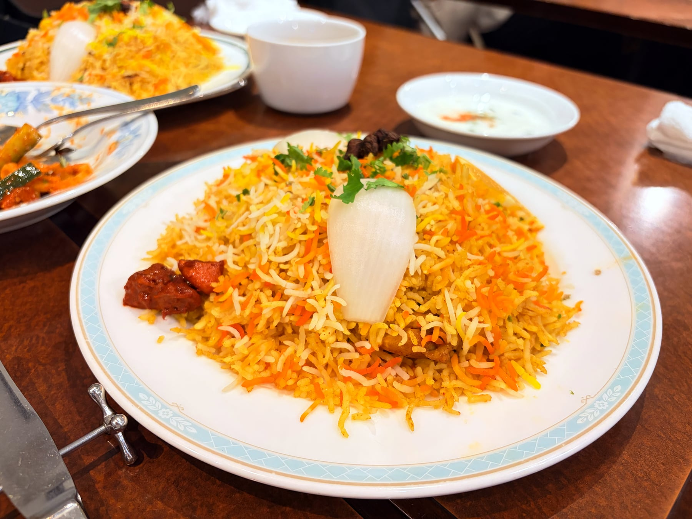

## 劇場版 魔法少女まどか☆マギカ〈ワルプルギスの廻天〉

『叛逆の物語』を復習して観に行った。もう13年も前とは……。

近所の映画館だとちょうどいいスケジュールがなく、TOHOシネマズ上野で鑑賞。
とくに意識していなかったが、今回の劇場は「[轟音シアター](https://www.tohotheater.jp/service/goon/)」仕様で強力なサブウーファーが導入されているとのこと。
そんなにドカドカ鳴る映画ではないし全力は発揮していなかっただろうが、たしかに音響の良さを感じた。下の階はレストランフロアでご飯もすぐに行けるし、混みすぎてもいないし上野は結構穴場かも。

内容は賛否両論らしいが、個人的には否寄りかな〜という感じ。
製作が長引くうちにやりたいことを詰め込みすぎてテーマがぼやけてしまった印象を受けた。

TVシリーズではまどかの選択によってすべての魔女を救ったが、ほむらの本心は救えていなかった。ほむらは円環の理に「叛逆」し、まどかの人格を切り離して悪魔となった。では続編ではまどかとほむらの真意を巡る物語をまず期待するが、曖昧な回答しか得られなかったのが残念。

まどかは最終的に円環の理に帰ったことと、マルグリートの境遇も踏まえると、やはり円環の理に戻ってすべての魔女を浄化することがまどかの意思であると解釈した。
ただし円環の理はすでにインキュベーターの支配化にあるのではないかとの考察もあり、本当のところはまだわからないと言うしかなさそう。
続きがあるような終わり方は置いておくとしても、まどか・ほむら・マミ・さやか・杏子の5人の物語には区切りをつけてほしかった。

## ハリマ・ケバブ・ビリヤニ

ちょうどTOHOシネマズ上野から近かったので、以前から気になっていたハリマ・ケバブ・ビリヤニに行った。

カチュンバルサラダとサモサに、ビリヤニを2つ頼み、一緒に盛られて来たのかな？と思ったらこれが一人前だった。
自分が頼んだチキンビリヤニがマトンビリヤニより異様に辛くて大変だったがさすがの美味しさ。当然食べきれず持ち帰らせてもらった。
インド料理は目測を誤りがちだけど、たいてい持ち帰りができてありがたい。

## 大腸カメラ検査

体調不良がただの風邪だと思っていたころに受診した病院が消化器内科で、ついでに以前からお腹の調子が悪かったのを相談してみた。
結論としては過敏性腸症候群と診断され、腸の過剰な運動を抑えて下痢を改善する薬を飲んだところ安定してきた。かがくのちからってすげー。

過敏性腸症候群は大腸にがんや炎症などの目立った症状がないことが前提らしく、念のため検査もやりましょうとなり大腸カメラ検査をした。
鎮静剤を希望したので検査自体は一瞬で終わったが、大腸を空にするために下剤を飲む必要がありだいぶきつい。異常はなかったもののポリープが見つかり、腫瘍ができやすい体質かもしれないから定期的に検査したほうがよいとのこと。

3年に1回くらいでいいらしいけど、3年ごとに下剤か〜〜となった。

## ブログをリニューアルした

時間ができたので何かやらなきゃという気持ちになり、GPT-6 Astraと一緒にブログをリニューアルした。
大枠は完成して、今は細かい調整を続けているところ。ひととおりやりきったら別で記事を書きたい。

コンセプトを指示してモックを作成し、モックで見た目を作り込んでからHugoのテーマとして実装する方針で開発した。
Astraはモックもそれっぽいものを作ってくれたし、アイコンも思い描いたものがすぐ出てきて、ビジュアルを取り扱う能力が向上していると感じた。
これまでアイコン作りがネックになりがちだったのでこのレベルで作ってくれるのは素晴らしい。

やりすぎて休めなかったら本末転倒なのは重々承知しており、いまは意識的に休むように心がけてはいる。
いったんリリースできた段階で満足して気分が落ち着いたし、まあ休むためのステップだったということで。
